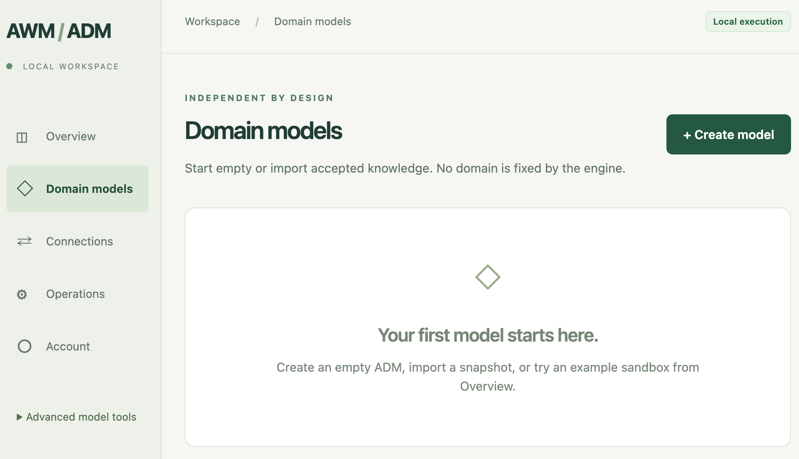

# AWM-ADM

**Independent models. Checked learning. Reasoning you can inspect.**

AWM-ADM is a service for building and using **Algebraic Domain Models (ADMs)**: independently maintained models with explicit concepts, rules, evidence and supported operations. It combines LLM-assisted learning and conversation with an accepted model that can be inspected, revised and executed under its owner's control.

The project is inspired by [Algebraic World Model: From Exploration to Proofs](https://arxiv.org/html/2610.40503v1), which develops explicit models of particular environments and uses them for formal reasoning. Our focus is a practical service in which each ADM develops its own domain knowledge and history. A model can start empty or from a checked snapshot; the engine does not prescribe its domain. Equipment checkout, water tanks and access permissions are examples, not built-in restrictions.

An external LLM helps interpret requests, propose knowledge and explain outcomes. The ADM validates proposed changes and executes supported queries against its accepted model. Learning can continue in the background while accepted capabilities remain available. Provider output is fallible; only checked, admitted content becomes active knowledge, and fluent explanations remain separate from computed results.

Independent ownership, the learning/serving separation, forward/backward conflict policies and budgeted service workflows are **our ADM design choices**. AWM already uses LLM agents and environment-specific models; these choices describe how we apply its ideas. See [the foundation and implementation boundaries](docs/REFERENCES.md).

**[Explore AWM-ADM on concourses.net](https://concourses.net/awm-adm.html)** for the motivation, architecture and examples.

**Release: 0.3.0 · MIT license · Supported Docker target: Linux ARM64**



*The Domain models workspace: create an empty ADM, import a checked snapshot or try an example.*

## The idea behind AWM-ADM

I want AI systems to develop knowledge that stays explicit, inspectable and consistently usable over time. As an assistant takes on more work, it should be clear which rules it has accepted, what evidence supports them and how new information can change them.

Context and harness engineering help organize information, tools and checks around an LLM. I want to complement that work with a maintained domain model: one whose supported consequences can be computed and checked independently of how the LLM interprets a conversation on any particular turn.

AWM-ADM is my first step toward that architecture. It combines the breadth and flexibility of an LLM with explicit domain knowledge, controlled learning and inspectable execution. The model can acquire new capabilities while proposed changes remain subject to independent owner requirements. It can also preserve a gap when the available knowledge does not support an answer.

The longer-term aim is for an ADM to become a **logic guide for an LLM-driven system**, supplying accepted rules and checked results that help shape its decisions. Possible future applications include software agents, workflow automation and robotic systems. Turning guidance into control would require application-specific integration that makes the relevant checks mandatory before an action can execute.

## What you can do

- **Ask** questions in a durable chat. A funded provider translates the request; the local model computes the answer. Optional AI explanations remain separate from the authoritative result.
- **Teach** capabilities through conversation and attach Markdown, text, JSON or JSONL. Review the intended meaning, set an allowance and let bounded acquisition, validation and admission proceed in the background.
- **Use evidence over time.** Retain source provenance, dated facts and corrections. Missing evidence stays unknown. Managed push queues accept ongoing material within explicit limits.
- **Own independent models.** Create, name, clone, import/export snapshots, archive or delete a model. Each model has its own accepted theory and history.
- **Choose conflict behavior.** Backward mode retains earlier-arriving conflicting knowledge; forward mode prefers the later result, subject to validation and dependent-conclusion handling. Switching applies to future decisions.
- **Work locally.** Local debug evaluates accepted functions, checks claims, plans and looks up historical facts without a provider. Details exposes exact requests, results, evidence and accounting.

## Quick start with Docker

Requirements:

- An ARM64 host with Docker Engine/Desktop running Linux containers and Docker Compose v2. Apple Silicon is supported; AMD64 is not verified for this release.
- Python 3.10 or later on the host for the setup helper scripts. The Python 3.13 application, Node build and Lean 4.19.0 compiler are installed inside the images.
- Internet access for the initial dependency/toolchain build, and sufficient Docker disk space. A provider account is optional for local execution; normal Ask/Teach interaction requires a configured, funded supported connection.

From the repository directory:

```sh
python3 scripts/setup_runtime.py
docker compose build
docker compose up -d --no-build --wait --wait-timeout 60
docker compose ps
```

Open **[http://127.0.0.1:8080/](http://127.0.0.1:8080/)**. The three services are the application, learning worker and provider gateway. Only the application is published, on loopback.

Create the administrator setup credential:

```sh
python3 scripts/admin_credential.py bootstrap --project awm-adm
```

The command prints the path to a private credential file, not its value. Open that file locally, paste its contents into **Setup credential**, choose your email and password, and click **Create administrator**. The credential is single-use and expires after 15 minutes. Delete the file after use. Subsequent sign-ins use email/password; no email is sent.

No API key belongs in these commands or in a committed `.env` file. See [installation and troubleshooting](docs/INSTALLATION.md) for configuration, restart and recovery.

## Your first model

1. Sign in and create an empty model under **Domain models**, or import a checked snapshot.
2. For chat, configure a provider in **Connections** and enter its key privately. Select the required purposes, review a supported price profile, configure separate interaction/learning spending limits and explicitly enable remote calls. Saving a connection does not make a paid call.
3. Open **Teach**, describe the capability or supplied material, and answer the allowance/scope questions. Review the preparation before starting. Some candidate meanings and source claims require a separate owner decision.
4. Open **Ask** to use accepted knowledge. If evidence is missing, the result remains unknown; opening a linked Teach conversation does not silently fund learning.
5. Use **Details** for technical records and **Local debug** for provider-free structured requests. **Advanced model tools** exposes manual Learning and Sources controls over the same models.

The [teaching example](examples/teaching/README.md) supplies a small equipment rule and dated history. [Console guide](docs/CONSOLE.md) explains the full workflow.

Provider availability and supported pricing are explicit configuration constraints. The transport adapters cover OpenAI, Anthropic and recorded responses, but priced chat requires a currently supported audited model/profile. There is no default allowance, automatic refill or automatic model switch. See [spending and supported profiles](docs/PRICED_ALLOWANCES.md).

## Stop, restart and protect data

```sh
docker compose stop
docker compose up -d --no-build --wait --wait-timeout 60
```

These commands preserve the named volumes. Keep `.local/secrets/` private: it includes the gateway encryption key needed to recover encrypted provider credentials. **Do not use `docker compose down -v` for normal shutdown; it deletes model and account storage.**

[Operational backup/restore](docs/OPERATIONS.md) captures both stopped storage owners. Model snapshots create independent models; they are not account/service backups. Recovery and updates must preserve uncertain provider reservations and accepted knowledge.

## Scope and guarantees

0.3.0 is a single-owner, single-host, loopback service with a bounded finite model language. Local acceptance checks enforce representation, independent owner requirements and configured admission rules. They do not establish that supplied premises are externally true. LLM interpretation and explanations remain fallible.

Lean kernel checking and exhaustive finite correspondence are reported separately. The interpreter and translator remain trusted code. Unknown provider usage stays reserved, and uncertain dispatched calls are not retried automatically. A learning allowance limits work; it cannot guarantee the requested knowledge will be acquired.

Cluster reasoning, federation, Byzantine coordination, public internet hosting, multiple administrators, physical action execution, pull connectors, general PDFs/OCR and unrestricted theorem proving are outside this release. See [release scope](docs/RELEASE.md) and [security boundary](SECURITY.md).

## Documentation and development

- [Documentation index](docs/README.md)
- [Architecture](docs/ARCHITECTURE.md) and [finite engine](docs/ENGINE.md)
- [API reference](docs/API.md) and [OpenAPI](contracts/openapi.json)
- [Contributing and local checks](CONTRIBUTING.md)
- [Testing and assurance boundaries](docs/TESTING.md)

The repository builds and tests on its own. It does not import a parent project or require private development history. The public API uses `/api/v1`. URL versioning is independent of the **AWM-ADM 0.3.0** product version and the existing schema/profile and snapshot format identifiers.

## Foundation and license

AWM-ADM is an independent implementation inspired by AWM. The [references](docs/REFERENCES.md) distinguish the paper's method from this service's architecture and verification scope. This repository is not an official distribution of the paper's code or a reproduction of its experiments.

AWM-ADM is distributed under the [MIT License](LICENSE). Bundled third-party material retains its own notices; see [Third-party notices](THIRD_PARTY_NOTICES.md).
