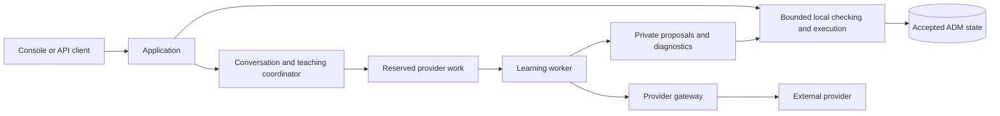

# Architecture

AWM-ADM separates locally accepted knowledge from fallible knowledge acquisition and conversational presentation. Every model owns its own finite theory, evidence support, owner requirements, revision history and conflict policy. Domain content belongs to the instance; example domains never become special cases in the engine.

This is the architecture of the ADM service we build using AWM ideas. Instance ownership, learning/serving separation, receipt-order conflict policies and the process boundaries below are our engineering contracts. The [foundation reference](REFERENCES.md) distinguishes them from the paper's method; the [project introduction](https://concourses.net/awm-adm.html) explains their motivation. Independent instances do not imply a distributed consensus or federation protocol.

## Process and authority boundaries

| Component | Responsibility |
| --- | --- |
| Application | Public API/console, local administrator, registry and ADM stores, exact owner decisions, local results and scheduling |
| Learning worker | Claims one reserved provider job and handles a bounded attempt; queueing alone does not mean a call is running |
| Provider gateway | Encrypted provider credentials, fixed provider transports, outbound access, at-most-once dispatch and usage outcomes |
| Compute children | Bounded finite validation, planning, source projection and optional Lean checks outside short database transactions |

The application and worker have no general provider egress. The supported Docker topology uses separate networks and an application seccomp profile. Provider credentials do not enter model snapshots, prompts or the frontend bundle. The local host/operator remains trusted.

## Accepted model and local serving

The finite engine supports typed values, pure functions, transitions, goals, assertions and bounded algebraic constructions. Supported requests include capabilities, evaluation, claim checks, planning, certificates and explanation of a retained result. Historical source queries use explicit entity/predicate/time with checked evidence support.

Each request pins an immutable revision. Results bind the request and attempt to the theory/support/policy context and exact query meaning. Explicit action lists differ from all-current-actions intent; witnesses, shortestness and unreachable claims are distinct. Work exhaustion is inconclusive, not proof of a knowledge gap. See [Engine](ENGINE.md) and [API](API.md).

## Learning and conversational interaction

Ask uses an explicitly funded provider to propose a read-only interpretation. A complete checked interpretation can run locally under its exact authority. Optional provider narration describes the recorded outcome and is labeled separately; fluent text cannot supply a missing local answer.

Teach prepares a bounded immutable specification, then requires execution authority. Acquisition, diagnostic revision, source extraction and checking happen privately. Only complete candidates that pass local admission and owner requirements become active. Semantic/source review remains necessary when automatic admission is not justified. Completion separates accepted work, unresolved objectives and unavailable explanation. See [Teaching](TEACHING.md) and [Execution](TEACHING_EXECUTION.md).

Learning and interaction have separate priced lanes and scheduling room. Reservations precede dispatch. Unknown usage retains its full hold, and expired or uncertain dispatched calls are not repeated automatically. No allowance promises a capability will be learned.

## Conflict and evidence boundaries

Receipt order is a local increasing sequence at the receiving ADM. Backward mode retains the earlier conflicting accepted knowledge; forward mode prefers the later result subject to full validation and dependency handling. Switching affects future decisions only. Individually consistent proposals may conflict when combined.

Source receipt, extracted claims and accepted knowledge are separate resources. Facts retain exact source versions and spans. Corrections can hold prior support before replacement is accepted. Unknown dates and disputed support remain gaps. A bounded managed push queue extends intake; it does not implement external polling connectors.

## Persistence and recovery

The registry, per-model SQLite stores and gateway ledger have separate transaction boundaries. Durable intents reconcile cross-store handoffs. Publication commits model/support/decision changes atomically within an ADM. Context generations, cancellation and deletion fence stale work.

Current owned schema is 15. Startup transactionally reconciles supported older stores and refuses foreign or future versions. Restoration preserves uncertain accounting while disabling remote authority and revoking operational credentials. Independent model snapshots recheck content and requirements without copying accounts, conversations or spending authority.

## Repository map

| Directory | Contents |
| --- | --- |
| `src/awm_adm/engine/` | Standard-library finite kernel, admission, planning, snapshots and proof templates |
| `src/awm_adm/application/`, `runtime/` | API, persistence, account and service runtime |
| `src/awm_adm/conversations/`, `teaching/`, `intake/` | Durable interaction, bounded orchestration and supplied material |
| `src/awm_adm/learning/`, `providers/`, `gateway/`, `allowances/` | Acquisition, transport and conservative accounting |
| `src/awm_adm/sources/`, `feeds/`, `lifecycle/`, `operations/` | Evidence, processing queues, model lifecycle and recovery |
| `console/` | React/TypeScript UI and native Node tests |
| `contracts/` | Generated schemas/OpenAPI, authored semantic fixtures and executable workflow specifications |
| `deploy/`, `config/` | Docker/toolchain pins, security profile and finite configuration |
| `tests/`, `examples/`, `scripts/` | Regressions, examples, setup and reproducible local verification |

Development history and private operational material are not build dependencies or public documentation. [Contributing](../CONTRIBUTING.md) describes standalone checks and exports.
