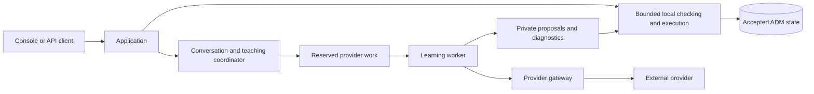

# Architecture

AWM-ADM separates locally accepted knowledge from fallible knowledge acquisition and conversational presentation. Every model owns its own finite theory, evidence support, owner requirements, revision history and conflict policy. Domain content belongs to the instance; example domains never become special cases in the engine.

This is the architecture of the ADM service we build using AWM ideas. Instance ownership, learning/serving separation, receipt-order conflict policies and the process boundaries below are our engineering contracts. The [foundation reference](REFERENCES.md) distinguishes them from the paper's method; the [project introduction](https://concourses.net/awm-adm.html) explains their motivation. Independent instances do not imply a distributed consensus or federation protocol.

## Process and authority boundaries

| Component | Responsibility |
| --- | --- |
| Application | Public API/console, local workspace, registry and ADM stores, local submissions, model controls, local results and scheduling |
| Learning worker | Claims one reserved provider job and handles a bounded attempt; queueing alone does not mean a call is running |
| Provider gateway | Encrypted provider credentials, fixed provider transports, outbound access, at-most-once dispatch and usage outcomes |
| Compute children | Bounded finite validation, planning, source projection and optional Lean checks outside short database transactions |

The application and worker have no general provider egress. The supported Docker topology uses separate networks and an application seccomp profile. Provider credentials do not enter model snapshots, prompts or the frontend bundle. The local host/operator remains trusted.

## Accepted model and local serving

The finite engine supports typed values, pure functions, transitions, goals, assertions and bounded algebraic constructions. Supported requests include capabilities, evaluation, claim checks, planning, certificates and explanation of a retained result. Historical source queries use explicit entity/predicate/time with checked evidence support. Bounded [evidence recall](EVIDENCE_RECALL.md) selects exact subject/property pairs across recorded scopes without requiring a time filter; results remain attributed collections, not inferred current values.

Each request pins an immutable revision. Results bind the request and attempt to the theory/support/policy context and exact query meaning. Explicit action lists differ from all-current-actions intent; witnesses, shortestness and unreachable claims are distinct. Work exhaustion is inconclusive, not proof of a knowledge gap. See [Engine](ENGINE.md) and [API](API.md).

## Learning and conversational interaction

A single tested connection supplies interpretation, acquisition, extraction and narration. Each direct Ask or Teach submission gets an independently pinned durable exchange beneath its model’s continuous channel. The service chooses bounded context; a transcript never becomes accepted theory by itself.

Ask obtains a read-only interpretation, validates it and executes supported operations in the ADM. A separately checked explanation refers to the saved outcome. Missing evidence, false results and exhausted computation remain distinct.

Shared meaning/representation guidance supplies a captured system timezone. A date-only historical question becomes a whole civil-day period with application-resolved UTC bounds. The source-service adapter checks complete active evidence coverage and value constancy; the finite core and source validators retain their contracts. See [temporal interpretation](TEMPORAL_INTERPRETATION.md).

A clear Teach submission authorizes preparation, bounded acquisition, checking and admissible publication within its expressed meaning and selected material. Ambiguity produces a clarification, not a routine approval form. Empty independent requirements do not prevent automatic admission; installed requirements remain mandatory and cannot be replaced by provider assertions. See [Teaching](TEACHING.md) and [Execution](TEACHING_EXECUTION.md).

Finite call, task, compute and storage bounds remain internal operating controls. Scheduling preserves capacity for local serving. There are no financial setup gates or idle clarification countdowns. Actual dispatch and usage are recorded once; an uncertain dispatched call is never repeated automatically.

## Conflict and evidence boundaries

Receipt order is a local increasing sequence at the receiving ADM. Backward mode retains the earlier conflicting accepted knowledge; forward mode prefers the later result subject to full validation and dependency handling. Switching affects future decisions only. Individually consistent proposals may conflict when combined.

Source receipt, extracted claims and accepted knowledge are separate resources. Facts retain exact source versions and spans. Corrections can hold prior support before replacement is accepted. Unknown dates and disputed support remain gaps. A bounded managed push queue extends intake; it does not implement external polling connectors.

## Codex project connector

The bundled `codex-plugin/` is a separate Python/MCP package. It binds the explicitly selected project to an ordinary model through the public API, keeps a private per-project work journal and reuses Ask/Teach. The service receives no repository identity or project path. Fixed tools cover readiness, create/bind, Ask, Teach, work/knowledge reads and explicit mode changes. Provider settings and broader model management remain in the console. Neither the skill nor the connector constitutes an enforcement gate.

New Ask/Teach intents can carry a revision precondition; identical retries recover the original retained interaction before applying that precondition to new work. Machine-readable admission receipts distinguish preservation conflicts, checked violations and unresolved work, and bind accepted replacements/removals to actual publication. The connector keeps these local results separate from provider narration. See the [plugin guide](../codex-plugin/README.md).

The project skill resolves discoverable factual gaps using relevant project material and Codex's available research tools before asking the user. Researched content keeps its sources; inferences retain premises, derivation and assumptions. Supported answers continue the existing Teach clarification, while unresolved evidence or user-owned choices still need a question. This adds no service web access, authority or validation exception, and externally researched answers are not checked model results.

## Persistence and recovery

The registry, per-model SQLite stores and gateway ledger have separate transaction boundaries. Durable intents reconcile cross-store handoffs. Publication commits model/support/decision changes atomically within an ADM. Context generations, cancellation and deletion fence stale work.

Current owned schema is 18. Startup transactionally reconciles supported older stores and refuses foreign or future versions. Restoration preserves uncertain accounting while disabling remote authority and revoking operational credentials. Independent model snapshots recheck content and requirements without copying accounts, conversations or provider credentials.

## Repository map

| Directory | Contents |
| --- | --- |
| `src/awm_adm/engine/` | Standard-library finite kernel, admission, planning, snapshots and proof templates |
| `src/awm_adm/application/`, `runtime/` | API, persistence, local workspace and service runtime |
| `src/awm_adm/interaction/`, `conversations/`, `teaching/`, `intake/` | Durable interaction, bounded orchestration and supplied material |
| `src/awm_adm/learning/`, `providers/`, `gateway/`, `allowances/` | Acquisition, transport, usage and historical accounting |
| `src/awm_adm/sources/`, `feeds/`, `lifecycle/`, `operations/` | Evidence, processing queues, model lifecycle and recovery |
| `console/` | React/TypeScript UI and native Node tests |
| `contracts/` | Generated schemas/OpenAPI, authored semantic fixtures and executable workflow specifications |
| `deploy/`, `config/` | Docker/toolchain pins, security profile and finite configuration |
| `tests/`, `examples/`, `scripts/` | Regressions, examples, setup and reproducible local verification |

Development history and private operational material are not build dependencies or public documentation. [Contributing](../CONTRIBUTING.md) describes standalone checks and exports.

## Temporal evidence

The service temporal adapter keeps instant observations, uncertain occurrences, interval validity, whole-period values and attributed reports distinct. It compiles accepted claims to ordinary finite constants with checked semantic/source bindings. Temporal filtering and coverage checking occur in bounded local compute, using the same publication, dependency and source-hold machinery. The algebraic kernel and certificate encodings are unchanged. See [temporal evidence](TEMPORAL_EVIDENCE.md).
