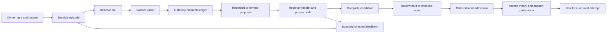

# Managed acquisition and provider connections

Managed learning adds bounded knowledge acquisition to the local AWM-ADM service. A provider proposes definitions or a complete candidate; a receiving ADM checks and publishes a complete theory before answering any attached request locally. The [language service](LANGUAGE.md), [source extraction](SOURCES.md) and [standing feeds](FEEDS.md) share the gateway and aggregate accounting.

## Owner workflow

1. Open **Connections**. Create an offline recorded connection or select OpenAI/Anthropic with an explicit model identifier. Connections start disabled. An enabled connection also needs gateway synchronization before use.
2. For a remote provider, supply a gateway-managed key or mount its static secret. Enable remote calls separately in the installation controls. Saving a connection never tests it or spends a call.
3. Select an ADM in **Learning**. Supply a task with a receiver-owned acquisition contract, select a connection version, choose publication policy and finite budgets. The authored capacity example supplies a small test task and recorded replies; its rules are fixture data, not engine behavior.
4. Optionally attach pending request IDs. Their local query intent remains unchanged. A successful publication creates a new local execution attempt on the new revision. Original revision pins and attempt history remain available.
5. Review complete candidates under the current revision, or use `checked_auto` after installing nonempty independent owner requirements. Approval removes the review hold; it cannot bypass admission.

A request with missing knowledge does not implicitly authorize a provider call. **Learn for this request** opens the episode form. The owner supplies the acquisition task, connection, disclosure choice and budget. Supplying multiple request IDs shares one episode. A request can also be interested in multiple explicitly authorized episodes. Cancelling all request interests stops request-owned work; an episode created without request interests is manual owner work until completion, exhaustion or cancellation.

## Provider and credential boundary

| Component | Authority and storage |
| --- | --- |
| Browser | Owner session and CSRF; seals a newly supplied provider key to the gateway public key before submitting it. No provider key or bearer token is stored in browser storage. |
| App | ADM stores, connection versions, encrypted credential-transfer envelopes, immutable acquisition tasks, reservations, episode/receipt history, publication and events. Its Linux seccomp policy denies outbound connection initiation. |
| Learning worker | Claims one bounded acquisition job and asks the internal gateway to dispatch it. Has no provider key, accepted-state storage or publication authority. |
| Provider gateway | Own encrypted credential store, dispatch ledger, authenticated app connection and provider egress. It authenticates workers and obtains app authorization before first dispatch. |
| Local compute children | Cold snapshot checking, schema decoding, construction and admission under work/time limits. No network or storage handles. Serving and background supervision have separate capacity. |

UI-managed credentials use RSA-OAEP with SHA-256 for browser-to-gateway sealing, bound to provider and idempotency key. The gateway stores credentials and its private sealing key using authenticated Fernet encryption. Credential plaintext binds the connection ID and version, preventing swapping ciphertext between rows. The master key is mounted only into the gateway as `gateway-master-key`; it is distinct from the gateway's service token. `.local/secrets/` is host-owner-only; container secret files are readable by the non-root container UID. Preserve the master key with any gateway backup: a different key cannot decrypt the store.

Static keys live at `.local/provider-secrets/openai-key` or `anthropic-key`, mounted read-only only into the gateway. Their parent `.local/` and secret directory should be accessible only to the owner on the host, with mount permissions allowing the container UID to read the files. Static keys are owner-managed files; update the connection version after replacing a mounted key so outstanding work is fenced. The gateway never accepts an arbitrary credential path or provider URL.

Connections explicitly allow acquisition, connection tests and/or interpretation. Enabling interpretation is an owner choice; existing permissions are preserved. Connection updates and rotations create new versions. Disabling a connection or changing its version revokes old dispatch and publication authority. Disabling installation remote access advances its authority generation; old episodes cannot revive when access is enabled again. Completed historical decisions are unchanged. A lost or invalid established gateway store fails startup rather than becoming an empty ledger.

Managed keys are write-only. The API exposes names, versions, model IDs, declared purposes/capabilities and synchronization state. It never returns decrypted credentials or sealed credential envelopes. Provider HTTP errors are reduced to safe codes. Raw headers, exception messages and hidden reasoning are not retained; direct and JSON-escaped credential reflections are rejected. Final structured output is bounded and untrusted.

## Transport and shared acquisition contract

| Adapter | Transport | Verification scope |
| --- | --- | --- |
| Recorded | Owner-supplied ordered array of complete structured replies, starting at index zero for each episode; recorded connection tests use a fixed `{"ok":true}` fixture | Offline service and browser fixture; zero reported input/output tokens, calls still counted |
| OpenAI | Fixed `api.openai.com/v1/responses`; `text.format` JSON Schema, `store:false`, `stream:false`, explicit output limit | Simulated response/error tests; no learning live compatibility measurement |
| Anthropic | Fixed `api.anthropic.com/v1/messages`; `output_config.format`, `max_tokens`, `stream:false`; pinned `anthropic-version: 2026-10-21` | Simulated response/error tests; no learning live compatibility measurement |

Model IDs are configuration data. They do not choose task semantics, instructions, decoder behavior, owner checks or schema branches. Both transports receive the same shared learning-role instructions and ordered schema. Recorded acquisition uses that same contract. Requested and returned model IDs, connection version/digest, prompt version/hash, canonical schema hash, ordered schema-wire hash, request hash, response ID and reported usage are retained as provenance.

Connections declare `json_schema` and `recursive_refs` capabilities; incompatible declarations fail before dispatch. Actual provider/model support can still reject a schema. Such a rejection is explicit; the service does not relax receiver validation, rewrite enums, swap models, strip recursive definitions, change an already dispatched schema or salvage truncated output. Source fact extraction uses the predefined [structural provider schema](SOURCES.md#provider-structure-and-local-validation) while preserving full local validation. Acquisition, language translation and projection-schema proposal contracts retain their existing schemas. A separately authorized live trial is needed to establish compatibility with an actual account/model combination.

An episode uses either receiver-owned interfaces plus provider definition slots (`construction=true`) or a complete structured proposal. The first attempt receives the learning role, task and exact acquisition contract. The provider context includes the task, interface contract, private draft and bounded checked failure feedback. The accepted model document is included only with `disclose_model=true`. Selecting false does not suppress task or draft disclosure. Independent owner requirements never originate from provider assertions and are not editable by a candidate.

## Budgets, leases and uncertainty

Limits are nested: installation/per-ADM quotas → episode totals → one-call caps. The service reserves a call plus estimated input and maximum output before exposing work to a worker. Input estimation uses UTF-8 request bytes plus 4,096 framing/schema overhead. This is a conservative operational estimate, not a proven tokenizer bound or a dollar-cost guarantee. Reported usage exceeding its reservation is charged in full, blocks publication and disables further remote dispatch until owner intervention.

The gateway records `dispatched` durably before sending one HTTPS request. It does not follow redirects, retry HTTP failures or automatically repeat an expired lease. Each grant carries a validated `awm-adm-dispatch-grant/2` and worker lease binding purpose, exact wire digest, connection, ADM context or installation control scope, attempt and expiry. Public client credentials cannot issue grants or change learning controls.

| Outcome | Accounting and next action |
| --- | --- |
| Proven not dispatched by the app | Release that reservation; no provider call was authorized. |
| Complete known response with validated nonzero remote usage | Charge one call and reported tokens. Check the structured output locally. |
| Remote response reporting zero input and zero output tokens | Preserve the report as `diagnostics.reported_usage`, mark `zero_unverified`, and retain the full token reservation with unsettled `usage: null`. Recorded offline fixtures retain ordinary zero-cost accounting. |
| Refusal, incomplete output or provider error | Stop the episode without executable salvage. Preserve safe structured diagnostics; settle only validated, non-suspicious usage and otherwise retain the reservation. |
| Rate limit | Stop with `rate_limited`; no hidden backoff retry or model fallback. A new bounded owner action is required. |
| Timeout, lost connection, expired dispatch lease or interrupted dispatch | `outcome_unknown`; retain full reservation, including across quota windows. Never automatically repeat the call. |
| Cached gateway outcome with a lost app acknowledgment | Deliver the same outcome again; never send the provider request again. Late known usage may settle accounting, but revoked work cannot publish. |

Quotas use a rolling configured period with a persisted clock high-water mark. Unresolved reservations count across periods. In-process authority expiry also advances with monotonic elapsed time. Per-call and aggregate input/output/call limits are independent of local checking work. Local work is reserved before a child starts; a completed child reports consumed work, while an interrupted child keeps its full reservation. Private drafts and retained histories have finite byte/item bounds and receive storage backpressure rather than unbounded growth.

The gateway runs at most two dispatches concurrently, and each remote call runs in a separate child with a whole-call wall deadline and process-group termination. App configuration may impose a smaller admission cap. Local background checking is fairly scheduled across ADMs by one coordinator, separate from the serving pool.

Only the explicit owner-reviewed publication hold may outlive acquisition's deadline. It cannot dispatch further calls. Releasing a hold uses the remaining local-work allowance and a fresh bounded check. If additional learning would be required after the deadline, the episode stops. A one-call episode uses `max_calls:1` and `no_progress_attempts:1`; neither call budgets nor deadlines promise closure of a knowledge gap.

## Provider diagnostics and usage assurance

Provider diagnostics retain only bounded, allowlisted metadata: HTTP status, response status, supported incomplete reasons, recognized provider error codes and validated token counters. An OpenAI incomplete response can identify `max_output_tokens`, `content_filter` or `steered`; absent or unsupported reasons are `unknown`. Anthropic `max_tokens` maps to the same output-limit reason. HTTP 429 with `insufficient_quota` is distinct from a rate-limit response. Arbitrary error messages, headers, hidden reasoning and partial output are not retained. Acquisition, Sources and Ask display these diagnostics without suggesting that incomplete output implies exhausted credit. The [official response guidance](https://developers.openai.com/api/docs/guides/reasoning#allocating-space-for-reasoning) describes output-limit incompleteness; it does not establish the cause of a particular response whose reason is unavailable.

Optional `token_details` preserve individually validated provider counters: OpenAI total, cached-input and reasoning tokens, or Anthropic cache-creation/read tokens. Missing, malformed, negative, Boolean and unsafe-integer values are omitted rather than replaced with zero or reconstructed from other counters. These details are reported evidence, not independently verified billing, and do not settle an otherwise unknown call.

For OpenAI, `reasoning_effort` and `reasoning_mode` retain allowlisted settings returned in the response. Missing settings remain unknown; unsupported non-null values are labeled `unknown`. Neither requested settings nor model defaults are substituted for response-side evidence. `output_summary` counts top-level message, text, reasoning and other items, plus recognized visible-text parts and their UTF-8 byte lengths. OpenAI `output` and Anthropic `content` use their respective item structures. Missing or malformed structures produce no summary; an explicit empty array produces measured zero counts. Unknown item type names, reasoning text, reasoning summaries/signatures and partial message content are never copied into diagnostics. Summary collection runs before incomplete output is discarded, so it can describe a partial response without admitting or displaying its content. The console shows returned reasoning settings and output size; full numeric details remain expandable. Existing historical outcomes are not backfilled with guessed metadata.

On startup, earlier terminal remote calls that settled a zero/zero report regain their original token reservations. Their stored outcomes, response identities, terminal statuses and model publications remain unchanged; repeated startup does not add reservations or dispatch again. Read views label these historical reports as unverified and distinguish reported counters from reserved counters. This conservative accounting adjustment does not reconstruct missing provider diagnostics or verify an account bill. Diagnostics exports exclude unresolved records from settled measured-usage totals.

## Construction, admission and serving

A local increasing receipt sequence is durably allocated in the receiving app registry with outcome accounting, before copying into that ADM’s inbox, decoding or semantic checking. Recovery copies the same sequence; a failed earlier inbox write cannot let later candidates overtake it. Incomplete/invalid replies become terminal receipt records; only complete packages enter admission. An unclassified earlier reply or an earlier review hold blocks later publication, while other acquisition and local serving can continue. Approvals bind the displayed current revision. Changed theory, support or owner policy requires review again. The latest selected conflict mode governs the next decision; historical decisions are not replayed.

The owned admission core performs dependency reconciliation, finite checking and independent conformance checking. Backward mode rejects later conflicting replacements/retractions as a terminal precedence decision. Forward mode may replace conflicting content and invalidates dependent conclusions according to the core contract. A candidate cannot bypass owner requirements in either mode. Per-declaration evidence support is retained; old origins are immutable.

Partial construction drafts never serve. A new attempt uses bounded local diagnostics under the same immutable task/contract. A changed base revision resets retained private draft and feedback before further acquisition. Repeated identical failures trigger the no-progress limit. Checker exhaustion, unavailable evidence, deadline, revocation and budget exhaustion preserve pending requests and diagnostics.

Accepted model, support, current revision, candidate decision and request wakeup events commit in one per-ADM transaction. Local queries rerun on newly pinned attempts; provider text is never a request result. Request action-selection intent is preserved. Cancelling another learning episode leaves an already queued or running local retry intact. Serving remains available during acquisition and gateway outage.

Registry reservations, gateway dispatches and per-ADM receipts are **separate durable transactions**, not a distributed atomic commit. Restart uses conservative fences: unfinished episodes stop, ready calls proved unissued are released, leased/dispatched calls become unknown and retain reservations. Completed accepted revisions and historical decisions survive. An owner can start another explicitly bounded episode; recovery never silently enlarges budgets or reissues uncertain work.

## API resources

All routes below require owner authority, including reads of connection and learning details. Ordinary scoped request tokens retain their read/submit authority only.

| Route under `/api/v1` | Operation |
| --- | --- |
| `GET/PUT /learning` | Inspect caps/usage/gateway sealing key; change remote-call authority with expected generation |
| `GET/POST /connections` | List safe metadata; create a versioned connection |
| `GET/PUT /connections/{id}` | Inspect safe configuration including recorded fixtures; update/rotate with expected version |
| `POST /connections/{id}/test` | Explicit one-call connection test with idempotency key and caps |
| `GET /dispatches/{id}` | Dispatch state, safe outcome and retained/settled usage |
| `GET/POST /adms/{id}/episodes` | Recent episode summaries; create a bounded episode with expected revision |
| `GET /adms/{id}/episodes/{episode}` | Immutable task, private draft, history, diagnostics, receipts and usage |
| `POST /adms/{id}/episodes/{episode}/cancel` | Revoke future dispatch/publication; retain spent or uncertain usage |
| `POST /adms/{id}/candidates/{receipt}/review` | Approve or decline against exact current revision |

Collection sizes are bounded; the console shows the latest 100 episodes and direct IDs remain addressable. Final structured outputs are limited to 256 KiB, provider HTTP responses to 2 MiB, gateway state to 64 MiB, and retained connection versions/dispatches to 1,000/10,000. Current retention has explicit capacity backpressure. The [operations guide](OPERATIONS.md) defines paired backup/restore and preserved unknown reservations; automatic evidence/idempotency cleanup remains disabled. There is no public raw dispatch, arbitrary URL, raw Lean source or provider-powered answer endpoint.

## Technical references

The service uses its local [acquisition/construction core](ENGINE.md). Fixed provider transports and cryptographic primitives are documented in [references](REFERENCES.md). These interfaces and tests do not establish external truth or general provider reliability.
