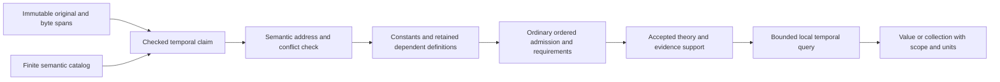

# Temporal evidence

See [knowledge intent](KNOWLEDGE_INTENT.md) for adopted rules, sourced observations, model-relative premises and exploratory or quoted material.

One ADM can retain observations at exact instants, uncertain occurrences, values valid throughout intervals and values for whole reporting periods. Ordinary Teach selects the representation from the supplied meaning. Ask proposes a typed question, and the service answers it against accepted evidence locally. These adapters use the existing finite declarations, conflict admission and independent requirements; they add no algebraic engine primitive.

## Meanings

| Subject scope | Meaning | Supported query |
| --- | --- | --- |
| `instant` | Value observed at one exact second; no persistence is implied | `value_at` |
| `occurrence` | Event or observation occurred somewhere within a bounded window; its exact instant is unknown | `observations_in` |
| `validity` | Value holds throughout a half-open interval | `value_at`, `value_throughout` |
| `period_value` | Value describes the exact period as a whole, such as a total | `value_for_period` |

A weekly total is not an instantaneous value or a rate. A dated occurrence is not a midnight observation or a value valid all day. Overlapping reporting periods do not imply arithmetic relationships. The adapter performs no interpolation, prorating, aggregation or extrapolation.

Each series has a finite Boolean, integer or enumeration carrier, exact unit, explicit meaning, supported scope kinds and bounded named qualifiers. Period values require a metric description. A `direct` series asserts the subject's value. A `reported` series records an attributed proposition with an actor and modality, such as a forecast; it does not establish the realized outcome. Separate properties must have separate accepted meanings. Renaming a property is not a supported way to revise it. The software cannot identify every semantic synonym from prose.

Subject scope, observed time, reported time and local receipt time are distinct. Optional observed/reported anchors are exact, window or unknown. A report requires a supported report occurrence; the receipt clock cannot supply it. A source-supported occurrence identifier may link uncertain occurrences. Otherwise original span identity keeps them separate without claiming they occurred simultaneously.

## Closed contracts

`awm-adm-temporal-catalog/1` retains `namespace`, `entities`, `predicates` and `cells` under a distinct profile. Predicates extend the finite carrier with `meaning`, `statement_level`, nullable `actor`/`modality`, `qualifiers`, `scope_kinds` and nullable `metric`. Cells have `kind`, canonical UTC-second `effective_from`, nullable `effective_to`, `precision` and `timezone_basis`. Bounds are nonempty and half-open; an instant has second precision and no end. Precision and the captured IANA timezone remain evidence metadata, independent of UTC encoding. Newly authored claims cannot use compatibility-only legacy precision.

Predicate symbols are complete dot-qualified identifiers; the catalog namespace never supplies an implicit prefix. Provider-facing fields carry the same general identifier, unit, finite-carrier and time guidance used in preparation instructions. An exact clock instant uses `precision: second` with no end: this is the supported coordinate resolution, not an assertion about instrument accuracy. An approximate or rounded observation retains a supported occurrence window and its precision; missing bounds or meaning require clarification, never fabricated precision. The relevant explicit timezone overrides the captured system default.

`awm-adm-temporal-claim/1` binds an entity, predicate, typed value, exact unit, subject scope, assertion kind, optional observed/reported anchors, optional occurrence identity and service-owned original source/span identity. Only explicit eligible assertions compile. A supported assertion that an actor made a report belongs to its attributed series, not to a direct outcome series. Quotations, hypotheticals and negations are not silently promoted to positive facts.

Machine-readable contracts: [catalog](../contracts/schemas/TemporalCatalog.schema.json), [claim](../contracts/schemas/TemporalClaim.schema.json), [extraction](../contracts/schemas/TemporalExtraction.schema.json), [query](../contracts/schemas/EvidenceQuery.schema.json).

## Catalog capacity and working sets

The accumulated temporal registry supports 65,536 predicates, independently of a proposed mapping's 32-predicate/4,096-address working set. Unused combinations assert no facts. Semantic identity and carrier checks apply to the complete extension; exact duplicate descriptors are shared, while meaning changes are refused. A `catalog_capacity_exceeded` diagnostic reports counts without exposing raw values. See [limits](LIMITS.md) for independent byte, fact, compute and language bounds.

Preparation and Ask receive bounded, explicitly complete or partial catalog views. Ask also ranks retained fact metadata into a bounded disclosure window; absence from that window does not establish absence of knowledge. Exact local query validation still uses pinned model identities and support. Source extraction uses exact selected predicate identities; Teach derives them from the checked child mapping. Direct jobs and feeds may set `catalog_predicates`. Claims outside that selection remain held under ordinary validation. Each new binding stores the one entity, descriptor and selected scope it needs; old full-catalog bindings remain readable without changing their bytes or semantic addresses.

## Compilation and revisions



An accepted temporal fact compiles to an ordinary zero-argument finite function plus a `awm-adm-temporal-binding/1` evidence annotation. The annotation binds its checked value, semantic descriptor, temporal address, original bytes/spans and optional legacy-symbol bridge. It is authoritative evidence, not an external database index. Cold reads and import recheck it against executable definitions and source identity.

The semantic address excludes value, provider, catalog generation, namespace partition, display timezone and receipt time. It includes subject/property identity, statement level, relevant metric/qualifiers, subject scope and any modeled report occurrence. Exact direct assertions from different sources can conflict. Different dated reports can coexist as reports. Unknown occurrence relationships do not manufacture a contradiction or scalar answer.

Backward mode retains earlier accepted content. Forward mode admits a later exact replacement only after full checks. Exact compatible replacements reuse declaration symbols, including checked legacy bridges. Accepted dependent bodies and evidence are retained and rechecked with the complete candidate. Independent requirements apply in both modes. Conflicting records in one extraction do not receive precedence from array order.

A point can conflict with an interval containing it. A contradictory partial overlap is rejected in backward mode. Forward mode reports `unsupported_temporal_revision` when replacing it would require splitting an accepted interval: the remaining interval is not discarded. Descriptor changes that would alter accepted units or meaning are also unsupported as additive coverage. These failures retain bounded, receiver-authored explanations in the source episode and teaching outcome.

Each original's selected claims form one checked candidate. A multi-original Teach task can have several publications; completion reports preserve earlier accepted portions if another portion fails. There is no claim of task-wide atomic publication. Receiver sequence, revision/source-generation, cancellation and deletion fences remain authoritative.

[Evidence recall](EVIDENCE_RECALL.md) also enumerates accepted records selected by exact entity/predicate pairs without a time filter. It returns original typed scopes and provenance; it does not infer the latest value or a new calculation.

## Local queries

Submit `query_evidence` through the existing `POST /api/v1/adms/{adm}/requests` route:

```json
{
  "idempotency_key": "weekly-output-question",
  "query": {
    "op": "query_evidence",
    "intent": "value_for_period",
    "entity_id": "machine",
    "predicate": "machine.output",
    "scope": {
      "kind": "period_value",
      "effective_from": "2026-03-01T00:00:00Z",
      "effective_to": "2026-03-08T00:00:00Z",
      "precision": "day",
      "timezone_basis": "UTC"
    },
    "reported_time": null,
    "relation": "contained",
    "limit": 100,
    "cursor": null
  }
}
```

This is a synthetic request, not a built-in model. The catalog alone never proves that this value exists.

- `value_at` accepts direct instant or covering validity support for the selected series. An attributed series remains attributed in its result.
- `value_throughout` requires complete active validity coverage and one supported value across it. Missing coverage, disputes, varying values and ambiguous reports remain distinct `needs_input` reasons.
- `value_for_period` requires an exact target period; a report version may be selected by `reported_time`. Several matching report occurrences never silently become “latest.”
- `observations_in` returns accepted instant/occurrence records in a bounded window. `reports_about` returns attributed statements about a subject window. `contained` requires containment; `possibly_overlapping` explicitly includes uncertain overlap.

Collections sort by subject start and declaration symbol. Pages contain at most 100 items, with query/context/theory/support-bound cursors. `complete` means this packet contains the entire matching collection; `enumeration_complete` means there are no later pages. A later page is not a complete first page. A stale cursor is refused. An empty complete collection establishes only that no matching accepted record was found. It proves no absence in the world. Display summaries may abbreviate a larger packet and say so.

Results bind query intent, scope, descriptor digests, selected declarations, support root and completeness. Scalar presentation metadata includes exact units and attribution. Narration receives the same checked metadata as the deterministic answer. Cold checks, filtering, coverage, finite evaluation and result construction share request work/time limits. Exhaustion is inconclusive. No provider call is required for structured local serving.

## Sources, conversation and compatibility

Fresh material-aware Teach uses `adm-teaching-preparation/16`, `awm-adm-teaching-reply/6`, a shared `plan.evidence_scope` and local plan `awm-adm-teaching-plan/2`. Material IDs select immutable originals from the service manifest. A mixed original does not need separate extraction calls solely because its temporal kinds differ. Typed source extraction uses `adm-source-extraction/7`, chosen by the immutable catalog before dispatch. Retained older jobs use their recorded decoders. No failed or uncertain dispatch is automatically retried under a newer format.

Ask can propose `query evidence with {…}`. For a calendar-day window it may use `{kind,effective_on,timezone}`; application code resolves the whole civil day, using the captured system timezone unless explicitly overridden. It cannot use this form to invent an exact instant. See [temporal interpretation](TEMPORAL_INTERPRETATION.md).

Feeds, source APIs and the project plugin reuse these service workflows. Push credentials cannot enlarge their scope. No temporal configuration panel or plugin-specific reasoning engine is needed.

Legacy `awm-adm-projection/1`, claims, fact symbols, canonical engine encodings, saved results and certificates retain their original meaning. Read-only compatibility views identify legacy points as instants and intervals as validity, with unrecorded precision/zone provenance. Catalog extension preserves existing descriptors and cells. Exact compatible replacement carries a checked bridge to the old symbol; migration does not rewrite old knowledge.

Legacy `lookup_fact` and `lookup_fact_period` can read new direct instant/validity support through a lossless temporary view. They cannot read period values, imprecise occurrences or attributed reports as world-state facts. New typed queries can read compatible legacy evidence. Valid larger legacy catalogs retain their existing serving path; new extensions must satisfy current cumulative bounds.

Snapshots containing new bindings use `awm-adm-service-snapshot/1`, with required feature `temporal-evidence/1`, the unchanged core transport and its digest. Legacy-only exports keep their old shape. Missing/unknown feature declarations, stripped envelopes and forged bindings are refused. Older service readers reject the new envelope. This is a service compatibility boundary; an old core library parsing constants does not validate temporal semantics. Operational store schema 19 fences older binaries. Rollback uses a matching paired pre-upgrade backup, never a down-migration.

Source correction holds all affected support, including use through native finite queries and dependent definitions. Import retains those holds. Historical results and source originals remain immutable. Same-value accepted replacement can refresh support; changed values follow the mode and requirements.

Preparation failures retain allowlisted temporal field paths and fixed contract hints, without raw provider values or exception text. Ask uses `adm-ask-interpretation/temporal-4`. Stored preparation prompts `/10` and `/11` both select the same temporal reply decoder. Guidance annotations do not change local validation, and failed work is never replayed after a guidance update.

## Limits and assurance

The accumulated catalog permits 128 entities, 65,536 series and 256 normalized temporal scopes; one proposed mapping remains bounded to 32 series and 4,096 possible addresses. Extraction is at most 100 claims per original. Configured tighter limits still apply. Existing source/fact, child work/time, disclosure and teaching-child limits remain cumulative. A replacement retains at most 32 dependent definitions; oversized or incomplete groups do not publish partially.

These checks establish typed, model-relative computation and source identity. They do not prove source truth, extraction fidelity, universal semantic alias resolution or the correctness of the Python adapter. Lean and exhaustive-finite claims keep their existing separate meanings; no temporal adapter result invents a Lean proof. Validate the supplied evidence and its meaning for the intended application.

Missing temporal bounds or source clocks are assessed as information gaps when clarification can enable a supported representation. Missing data alone is not an unsupported temporal capability. See [preparation readiness](PREPARATION_READINESS.md); temporal validation still rejects invented, incomplete or invalid generated scopes.
